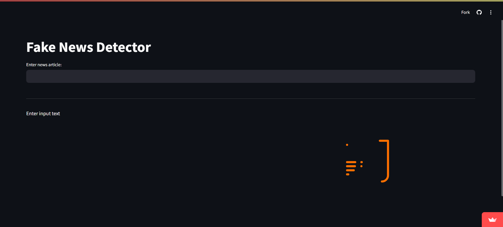

# Fake News Detector

A small classroom project: a text classifier that guesses whether a news article looks like the "Fake" or the "True" articles in a public Kaggle dataset. It is a TF-IDF + logistic regression model with a Streamlit page. It does not check facts, and it does not use any large language model.



## Measured results

Dataset: Kaggle "Fake and Real News" (`assets/Dataset/Fake.csv`, `True.csv`), 38,639 articles after removing exact duplicate texts. Split: stratified 80/20, `random_state=42` (30,911 train, 7,728 test). "Fake" is the positive class. Reproduce with `python train.py` (writes `metrics.json`).

| Setting | Accuracy | Precision | Recall | F1 |
|---|---|---|---|---|
| Text as is | 98.49% | 99.13% | 97.51% | 98.31% |
| "Reuters" mentions and datelines removed | 97.85% | 98.68% | 96.53% | 97.60% |

## Read this before trusting the numbers

This dataset is easy for a style reason, not because the model understands truth. Almost every article in the True set comes from Reuters and starts with a dateline such as "WASHINGTON (Reuters) -". The Fake set comes from other sites with different habits. A model can score high by learning those habits. Removing the Reuters cues only dropped accuracy by about 0.6 points, which means other style differences (topics, punctuation, wording) still give the answer away. Expect much worse results on articles from other sources, other years, or other topics. The score measures how well the model separates this dataset, nothing more.

## Run it

```
pip install -r requirements.txt
streamlit run website.py
```

With Docker:

```
docker compose up --build   # http://127.0.0.1:18501
```

`model/model.joblib` is the trained model (about 1 MB). `train.py` retrains it from the CSVs.

## Live demo

No public demo is running right now. The earlier Streamlit Cloud link no longer works. The page at fake-news-detector-beryl.vercel.app is not built from this repository, and its accuracy and technology claims are not backed by anything here.

## Repository notes

- The earlier version preprocessed text with spaCy and NLTK. It was replaced with scikit-learn's built-in stop word list to keep the app small and fast, and the numbers above are for the current model.
- `fake-news-detector.ipynb` is the original exploration notebook. Its stored outputs were not re-run.
- `presentation/` and `design/` hold the original course material.
